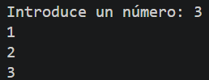
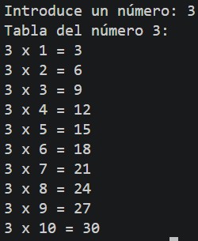
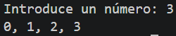
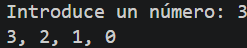
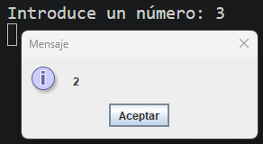

# Tarea Complementaria: Bucles y Generación de Secuencias
Conjunto de programas prácticos en Java para trabajar con bucles `for`, secuencias numéricas, formateo de cadenas y ventanas emergentes interactivas.

## 🚀 Resultado Visual










## 🛠️ Tecnologías utilizadas
- Java (JDK)
- Clase `Scanner` (Entrada por consola)
- Librería `javax.swing.JOptionPane` (Ventanas emergentes)

## 📋 ¿Qué se hizo? (Funcionalidades)
- **`tcbucles.java`**:
  - Conteo numérico progresivo desde 1 hasta el límite indicado por el usuario.
- **`tcbucles1.java`**:
  - Generación de la tabla de multiplicar del 1 al 10 para el número ingresado por teclado.
- **`tcbucles2.java`**:
  - Muestra de la secuencia numérica del 0 al valor introducido, separando los elementos por comas.
- **`tcbucles3.java`**:
  - Implementación de una cuenta atrás desde el número especificado hasta el 0, formateada con comas.
- **`tcbucles4.java`**:
  - Búsqueda de números pares positivos inferiores al límite introducido y despliegue del resultado en una ventana emergente (`JOptionPane`) con saltos de línea.

## ⚙️ Cómo ejecutarlo localmente
1. Abre la terminal en la raíz del proyecto.
2. Compila el archivo que quieras ejecutar:
   ```bash
   javac tcbucles.java
   # o bien:
   javac tcbucles1.java
   # o bien:
   javac tcbucles2.java
   # o bien:
   javac tcbucles3.java
   # o bien:
   javac tcbucles4.java
3. Ejecuta el programa:
   ```bash
   java tcbucles
   java tcbucles1
   java tcbucles2
   java tcbucles3
   java tcbucles4