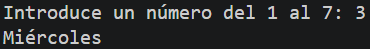
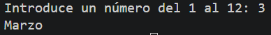

# Tarea Complementaria: Estructuras Condicionales Múltiples (Días y Meses)
Conjunto de programas en Java para practicar la evaluación de entradas numéricas por teclado y la correspondencia condicional con días de la semana y meses del año.

## 🚀 Resultado Visual




## 🛠️ Tecnologías utilizadas
- Java (JDK)
- Clase `Scanner` (Entrada por consola)

## 📋 ¿Qué se hizo? (Funcionalidades)
- **`tcif.java`**:
  - Evaluación de un número entero del 1 al 7 para determinar e imprimir por pantalla el día de la semana equivalente (Lunes a Domingo).
- **`tcif1.java`**:
  - Implementación alternativa del selector condicional de días de la semana.
- **`tcif2.java`**:
  - Entrada de un entero del 1 al 12 e impresión del nombre del mes del año correspondiente (Enero a Diciembre).
- **`tcif3.java`**:
  - Implementación del programa de mapeo de meses mediante evaluación condicional directa de la variable introducida por el usuario.

## ⚙️ Cómo ejecutarlo localmente
1. Abre la terminal en la raíz del proyecto.
2. Compila el archivo que quieras ejecutar:
   ```bash
   javac tcif.java
   # o bien:
   javac tcif1.java
   # o bien:
   javac tcif2.java
   # o bien:
   javac tcif3.java
3. Ejecuta el programa:
   ```bash
   java tcif
   java tcif2
   java tcif3
