# Tarea Complementaria: Ejercicios de Estructuras Condicionales y Bucles
Colección completa de ejercicios prácticos en Java para el dominio de condicionales (`if`/`else`), bucles (`for`, `while`, `do-while`), juegos de lógica, cálculo de estadísticas y generación de secuencias numéricas.

## 🛠️ Tecnologías utilizadas
- Java (JDK)
- Clase `Scanner` (Entrada por consola)

## 📋 ¿Qué se hizo? (Funcionalidades)
- **`tareacif1.java`**: Comprobación de número positivo o negativo.
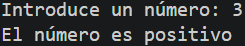


- **`tareacif2.java`**: Evaluación de si dos números enteros son múltiplos entre sí.
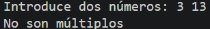


- **`tareacif3.java`**: Comparación de dos números indicando el mayor o si son iguales.
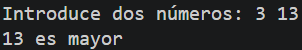


- **`tareacif4.java`**: Ordenación e impresión de tres números de mayor a menor.
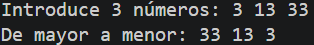


- **`tareacif5.java`**: Calificación de una nota del 0 al 10 en formato textual (Insuficiente, Suficiente, Bien, Notable, Sobresaliente).
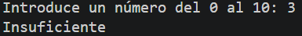


- **`tareacif6.java`**: Bucle que evalúa si los números introducidos son positivos o negativos hasta teclear un 0.
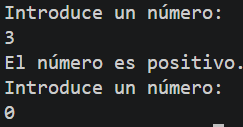


- **`tareacif7.java`**: Bucle continuo para determinar la paridad de números introducidos hasta pulsar 0.
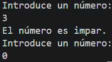


- **`tareacif8.java`**: Juego interactivo para adivinar un número objetivo recibiendo pistas de "mayor" o "menor".
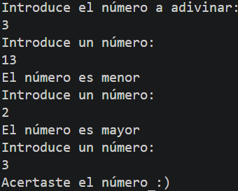


- **`tareacif9.java`**: Acumulador numérico que muestra la suma total de las entradas hasta ingresar un 0.
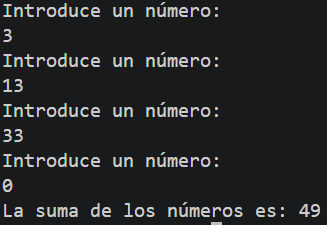


- **`tareacif10.java`**: Cálculo de la media de números positivos introducidos hasta teclear un valor negativo.
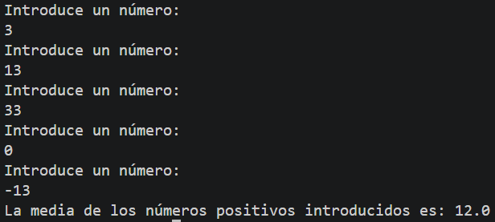


- **`tareacif11.java`**: Secuencia numérica ascendente desde el 1 hasta un límite `N`.
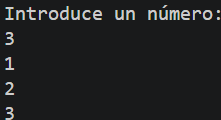


- **`tareacif12.java`**: Regresión numérica desde el 100 hasta el 0 decrementando de 7 en 7.
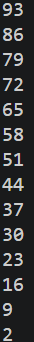


- **`tareacif13.java`**: Cálculo del factorial de un número introducido por el usuario.
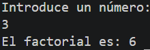


- **`tareacif14.java`**: Lectura de 10 números con cálculo de media de positivos, media de negativos y recuento de ceros.
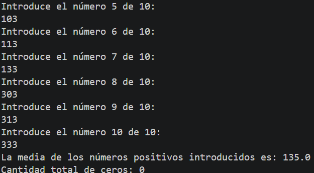


- **`tareacif15.java`**: Recopilación de edades y estaturas de 5 alumnos para calcular sus medias y contar mayores de 18 años o más de 1.75 m.
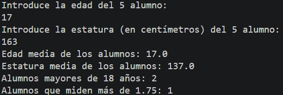


- **`tareacif16.java`**: Generación de la tabla de multiplicar de un número validado en el rango de 0 a 10.
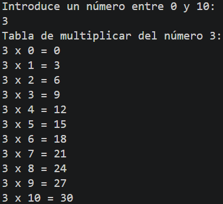


- **`tareacif17.java`**: Evaluación de 6 notas mostrando el total de aprobados, condicionales (nota 4) y suspensos.
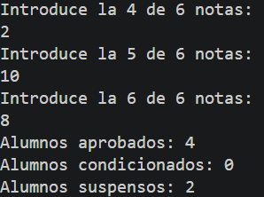


- **`tareacif18.java`**: Generación automática de todas las tablas de multiplicar del 1 al 10 mediante bucles anidados.
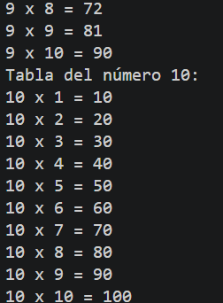


- **`tareacif19.java`**: Contador digital de 5 dígitos (0-0-0-0-0 a 9-9-9-9-9) sustituyendo cada aparición del número 3 por la letra 'E'.
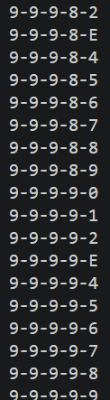


- **`tareacif20.java`**: Contador e identificador de la cantidad de números primos existentes entre 1 y un valor `N`.
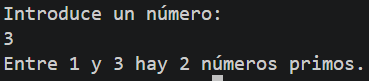


## ⚙️ Cómo ejecutarlo localmente
1. Abre la terminal en la raíz del proyecto.
2. Compila el archivo que quieras ejecutar:
   ```bash
   javac tareacif1.java
   # o bien:
   javac tareacif20.java
3. Ejecuta el programa:
   ```bash
   java tareacif1
   ...
   java tareacif20