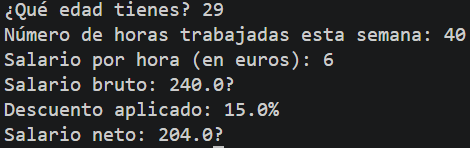

# Tarea 1: Cálculo de Salario Neto y Descuentos
Ejercicio práctico en Java para calcular el salario bruto, descuentos aplicados y salario neto en función de las horas trabajadas y la edad del usuario.

## 🚀 Resultado Visual

## 🛠️ Tecnologías utilizadas
- Java (JDK)
- Clase `Scanner` (Lectura de consola)

## 📋 ¿Qué se hizo? (Funcionalidades)
- Archivo fuente: `t1introducción.java`
- Lectura interactiva de la edad del usuario y validación de mayoría de edad.
- Captura de horas trabajadas semanalmente y tarifa por hora en euros.
- Cálculo de tramos de descuento según salario bruto:
  - Salario < 300€: 0% de descuento.
  - Salario entre 300€ y 600€: 10% de descuento.
  - Salario > 600€: 15% de descuento.
- Presentación de desglose de salario bruto, porcentaje de descuento y salario neto final.

## ⚙️ Cómo ejecutarlo localmente
1. Abre la terminal en la raíz del proyecto.
2. Compila el archivo Java:
   javac t1introducción.java
3. Ejecuta el programa:
  java t1introducción