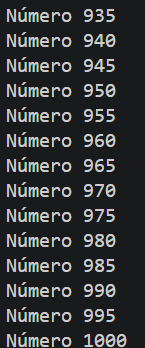
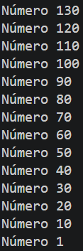
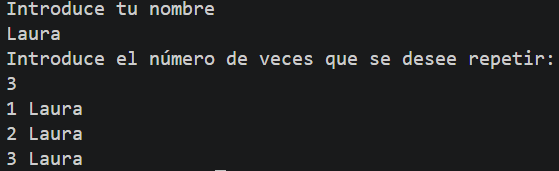
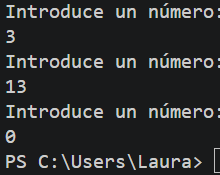

# Tarea 10: Bucles For, While y Do-While Avanzados
Conjunto de ejercicios prácticos en Java para consolidar el uso de bucles de repetición con incrementos, decrementos, repeticiones interactivas y condiciones de parada.

## 🚀 Resultado Visual








## 🛠️ Tecnologías utilizadas
- Java (JDK)
- Clase `Scanner` (Entrada por consola)

## 📋 ¿Qué se hizo? (Funcionalidades)
- **`t10bucles.java`**:
  - Impresión de números de 1 a 1000 con incremento de 5 en 5 utilizando un bucle `for`.
- **`t10bucles2.java`**:
  - Impresión regresiva de números del 10000 al 1 con decremento de 10 en 10 mediante un bucle `for`.
- **`t10bucles3.java`**:
  - Lectura por pantalla de un nombre y el número de repeticiones para imprimirlo dinámicamente.
- **`t10bucles4.java`**:
  - Solicitud continua de números enteros al usuario hasta teclear el valor 0 (condición de parada).
- **`t10bucles5.java`**:
  - Impresión de números del 1 al 100 mediante un bucle `do-while`.
- **`t10bucles6.java`**:
  - Impresión de números del 1 al 100 mediante un bucle `while`.

## ⚙️ Cómo ejecutarlo localmente
1. Abre la terminal en la raíz del proyecto.
2. Compila el archivo que quieras ejecutar:
   ```bash
   javac t10bucles.java
   # o bien:
   javac t10bucles2.java
   # o bien:
   javac t10bucles3.java
   # o bien:
   javac t10bucles4.java
   # o bien:
   javac t10bucles5.java
   # o bien:
   javac t10bucles6.java
3. Ejecuta el programa:
   ```bash
   java t10bucles
   java t10bucles2
   java t10bucles3
   java t10bucles4
   java t10bucles5
   java t10bucles6
