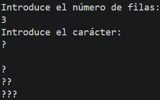
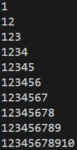
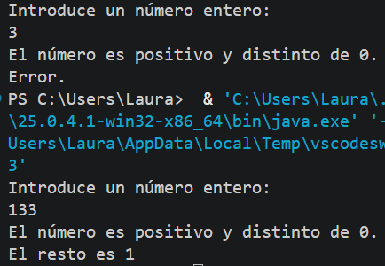
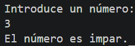

# Tarea 11: Bucles Anidados, Patrones Visuales y Lógica Condicional Avanzada
Conjunto de programas en Java para practicar el diseño de patrones de texto con bucles anidados, la generación de pirámides numéricas y la validación condicional mediante operadores lógicos.

## 🚀 Resultado Visual








## 🛠️ Tecnologías utilizadas
- Java (JDK)
- Clase `Scanner` (Entrada por consola)

## 📋 ¿Qué se hizo? (Funcionalidades)
- **`t11bucles.java`**:
  - Generación de un patrón piramidal en consola pidiendo dinámicamente el número de filas y el carácter de relleno mediante bucles `for` anidados.
- **`t11bucles2.java`**:
  - Creación de una pirámide de números secuenciales (del 1 al 10) utilizando bucles anidados.
- **`t11bucles3.java`**:
  - Validación de números enteros positivos de 2 cifras (determinando si son pares o impares) y de 3 cifras (calculando el resto al dividir entre 2).
- **`t11bucles4.java`**:
  - Comprobación de enteros positivos utilizando el operador de negación lógica `NOT` (`!`) y determinación de su paridad.

## ⚙️ Cómo ejecutarlo localmente
1. Abre la terminal en la raíz del proyecto.
2. Compila el archivo que quieras ejecutar:
   ```bash
   javac t11bucles.java
   # o bien:
   javac t11bucles2.java
   # o bien:
   javac t11bucles3.java
   # o bien:
   javac t11bucles4.java
3. Ejecuta el programa:
   ```bash
   java t11bucles
   java t11bucles2
   java t11bucles3
   java t11bucles4
   
   