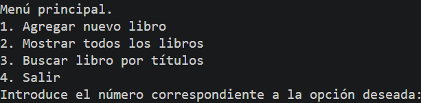

# Tarea 12: Gestión de Inventario de Librería con Estructuras de Control y ArrayList
Programa en Java para gestionar el inventario de una librería mediante un menú interactivo, utilizando clases internas, validaciones de entrada y manipulación de listas dinámicas (`ArrayList`).

## 🚀 Resultado Visual


## 🛠️ Tecnologías utilizadas
- Java (JDK)
- Clase `Scanner` (Entrada de datos y validaciones)
- Estructura `ArrayList` (Almacenamiento dinámico)

## 📋 ¿Qué se hizo? (Funcionalidades)
- **`t12bucles.java`**:
  - Definición de una clase interna `Libro` para representar las propiedades de título, autor, año de publicación y precio.
  - Implementación de un menú principal mediante un bucle `do-while` con opciones para agregar, listar, buscar y salir.
  - Validación de entradas numéricas positivas para el año de publicación y precio empleando bucles `while` y comprobaciones con `hasNextInt()` y `hasNextFloat()`.
  - Recorrido y visualización de todos los elementos almacenados en el `ArrayList` con un bucle `for`.
  - Búsqueda dinámica de libros por título utilizando un bucle `while` y comparación exacta de cadenas con `equals()`.

## ⚙️ Cómo ejecutarlo localmente
1. Abre la terminal en la raíz del proyecto.
2. Compila el archivo Java:
   ```bash
   javac t12bucles.java
3. Ejecuta el programa:
   ```bash
   java t12bucles