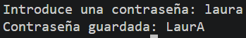
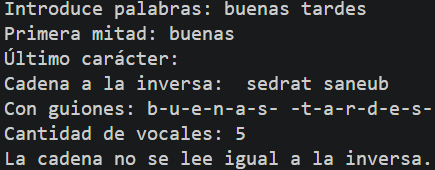
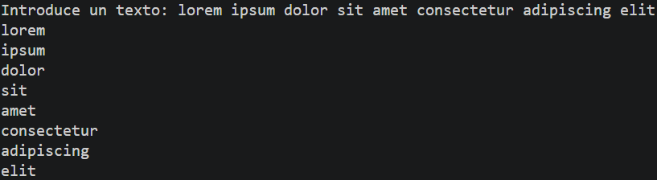

# Tarea 13: Métodos de la Clase String y Expresiones Regulares
Conjunto de programas en Java para manipular cadenas de texto, aplicar métodos de la clase `String`, validar contraseñas mediante expresiones regulares y procesar fragmentos textuales.

## 🚀 Resultado Visual






## 🛠️ Tecnologías utilizadas
- Java (JDK)
- Clase `Scanner` (Entrada por consola)
- Clases `String` y `Character` (Manipulación de texto)

## 📋 ¿Qué se hizo? (Funcionalidades)
- **`t13stringymath.java`**:
  - Validación de contraseña comprobando que no supere 25 caracteres y descartando caracteres especiales mediante expresiones regulares (`matches`).
  - Transformación automática de la primera y última letra a mayúsculas.
- **`t13stringymath1.java`**:
  - Implementación de métodos para extraer la primera mitad de caracteres, obtener el último carácter, invertir la cadena, separar caracteres con guiones, contar vocales y determinar si es un palíndromo.
- **`t13stringymath2.java`**:
  - Separación de una frase en palabras individuales utilizando la función `split` con la expresión regular `\\s+` para imprimir cada palabra en una línea distinta.

## ⚙️ Cómo ejecutarlo localmente
1. Abre la terminal en la raíz del proyecto.
2. Compila el archivo que quieras ejecutar:
   ```bash
   javac t13stringymath.java
   # o bien:
   javac t13stringymath1.java
   # o bien:
   javac t13stringymath2.java
3. Ejecuta el programa:
   ```bash
   java t13stringymath
   java t13stringymath1
   java t13stringymath2