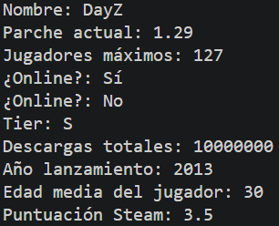

# Tarea 2: Declaración y Ficha de Datos con Variables

Ejercicio práctico en Java para poner en práctica la declaración y muestra de diferentes tipos de datos primitivos y referencias.

## 🚀 Resultado Visual


## 🛠️ Tecnologías utilizadas

- Java (JDK)

## 📋 ¿Qué se hizo? (Funcionalidades)

- Archivo fuente: `t2variables.java`
- Declaración de variables con los tipos `String`, `int`, `float`, `boolean`, `char`, `long`, `short`, `byte` y `double`.
- Asignación de valores a las variables.
- Construcción y muestra por consola de una ficha técnica completa del videojuego *DayZ*.

## ⚙️ Cómo ejecutarlo localmente

1. Abre la terminal en la raíz del proyecto.
2. Compila el archivo Java:
   ```bash
   javac t2variables.java
   ```
3. Ejecuta el programa:

   ```bash
   java t2variables
   ```