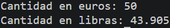

# Tarea 3: Conversor de Euros a Libras Esterlinas

Ejercicio práctico en Java para realizar conversiones de divisas a partir de entradas introducidas por teclado.

## 🚀 Resultado Visual


## 🛠️ Tecnologías utilizadas

- Java (JDK)
- Clase Scanner (Lectura de consola)

## 📋 ¿Qué se hizo? (Funcionalidades)

- Archivo fuente: t3euroconversor.java
- Lectura por teclado de una cantidad en euros.
- Aplicación de la tasa de cambio a libras esterlinas (0.8781).
- Impresión del resultado convertido en consola.

## ⚙️ Cómo ejecutarlo localmente

1. Abre la terminal en la raíz del proyecto.
2. Compila el archivo Java:

   ```bash
   javac t3euroconversor.java
   ```
3. Ejecuta el programa:

   ```bash
   java t3euroconversor
   ```