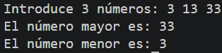

# Tarea 4: Evaluación de Números Mayor y Menor
Ejercicio práctico en Java para determinar el valor máximo y mínimo entre tres números mediante estructuras condicionales.

## 🚀 Resultado Visual


## 🛠️ Tecnologías utilizadas
- Java (JDK)
- Clase `Scanner`

## 📋 ¿Qué se hizo? (Funcionalidades)
- **`t4estructurasdecontrol.java`**:
  - Entrada de 3 números enteros por consola.
  - Determinación del número mayor y menor mediante bloques `if / else if / else`.
  - Muestra de los valores extremos encontrados.

## ⚙️ Cómo ejecutarlo localmente
1. Abre la terminal en la raíz del proyecto.
2. Compila el archivo Java:
   ```bash
   javac t4estructurasdecontrol.java