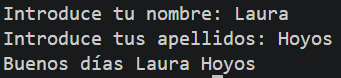

# Tarea 5: Saludo Personalizado con Captura de Texto
Ejercicio práctico en Java para capturar cadenas de texto completas por teclado y generar salidas formateadas.

## 🚀 Resultado Visual


## 🛠️ Tecnologías utilizadas
- Java (JDK)
- Clase `Scanner` (`nextLine()`)

## 📋 ¿Qué se hizo? (Funcionalidades)
- **`t5scanner.java`**:
  - Captura del nombre y apellidos del usuario de forma independiente.
  - Generación de un mensaje de saludo de bienvenida personalizado.

## ⚙️ Cómo ejecutarlo localmente
1. Abre la terminal en la raíz del proyecto.
2. Compila el archivo Java:
   ```bash
   javac t5scanner.java
3. Ejecuta el programa:
   ```bash
   java t5scanner