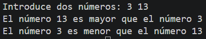
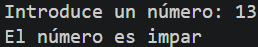

# Tarea 6: Estructuras de Control para Comparación y Paridad
Conjunto de programas en Java para evaluar relaciones de orden entre pares numéricos y determinar la paridad de un entero.

## 🚀 Resultado Visual




## 🛠️ Tecnologías utilizadas
- Java (JDK)
- Clase `Scanner`

## 📋 ¿Qué se hizo? (Funcionalidades)
- **`t6estructurasdecontrol.java`**:
  - Compara dos números enteros introducidos por el usuario e indica cuál es el mayor y cuál el menor.
- **`t6estructurasdecontrol2.java`**:
  - Lee un número entero y determina si es par o impar utilizando el operador módulo (`%`).

## ⚙️ Cómo ejecutarlo localmente
1. Abre la terminal en la raíz del proyecto.
2. Compila el ejercicio que quieras probar:
   ```bash
   # Para probar la comparación de números
   javac t6estructurasdecontrol.java

   # Para probar el cálculo de paridad
   javac t6estructurasdecontrol2.java
3. Ejecuta la clase correspondiente:
   ```bash
   java t6estructurasdecontrol

   java t6estructurasdecontrol2