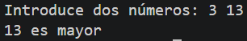
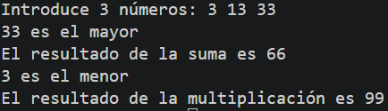
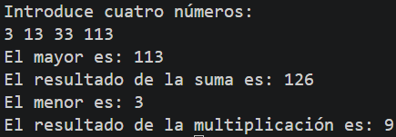

# Tarea 7: Operaciones Condicionales y Estructuras de Control Avanzadas
Conjunto de programas en Java que evalúan combinaciones de números, determinan valores extremos y realizan operaciones matemáticas asociadas.

## 🚀 Resultado Visual






## 🛠️ Tecnologías utilizadas
- Java (JDK)
- Clase `Scanner`

## 📋 ¿Qué se hizo? (Funcionalidades)
- **`t7estructurasdecontrol.java`**:
  - Comparación sencilla entre dos valores enteros para mostrar el de mayor valor.
- **`t7estructurasdecontrol2.java`**:
  - Comparación de 3 números con condicionales anidados, mostrando el mayor (y su suma) y el menor (y su multiplicación).
- **`t7estructurasdecontrol3.java`**:
  - Evaluación de 4 números introducidos por teclado. Determina el mayor y le suma el segundo número; encuentra el menor y lo multiplica por el primero.

## ⚙️ Cómo ejecutarlo localmente
1. Abre la terminal en la raíz del proyecto.
2. Compila el ejercicio que desees ejecutar:
   ```bash
   # Ejercicio 1 (2 números)
   javac t7estructurasdecontrol.java

   # Ejercicio 2 (3 números)
   javac t7estructurasdecontrol2.java

   # Ejercicio 3 (4 números)
   javac t7estructurasdecontrol3.java
3. Ejecuta la clase compilada según corresponda:
   ```bash
   java t7estructurasdecontrol

   java t7estructurasdecontrol2

   java t7estructurasdecontrol3