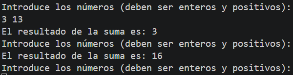

# Tarea 8: Control de Flujo con Bucle While y Acumulador
Ejercicio práctico en Java para implementar la lectura continua de datos numéricos y el cálculo acumulado mediante estructuras repetitivas.

## 🚀 Resultado Visual


## 🛠️ Tecnologías utilizadas
- Java (JDK)
- Clase `Scanner` (Entrada por consola)

## 📋 ¿Qué se hizo? (Funcionalidades)
- **`t8bucles.java`**:
  - Implementación de un bucle `while` para solicitar números enteros positivos de forma iterativa[cite: 124].
  - Acumulación y muestra en tiempo real de la suma parcial en cada iteración[cite: 124].
  - Detección de número negativo como condición de salida para finalizar la ejecución y presentar el total acumulado final[cite: 124].

## ⚙️ Cómo ejecutarlo localmente
1. Abre la terminal en la raíz del proyecto.
2. Compila el archivo Java:
   ```bash
   javac t8bucles.java
3. Ejecuta el programa:
   ```bash
   java t8bucles