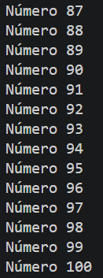
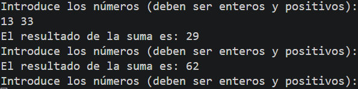
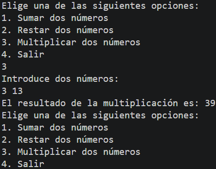

# Tarea 9: Estructuras Repetitivas (For, While, Do-While) y Menú Interactivo
Conjunto de programas en Java para ejercitar bucles de repetición, contadores, acumuladores y la creación de un menú interactivo en consola.

## 🚀 Resultado Visual






## 🛠️ Tecnologías utilizadas
- Java (JDK)
- Clase `Scanner` (Entrada por consola)

## 📋 ¿Qué se hizo? (Funcionalidades)
- **`t9bucles.java`**:
  - Impresión de números del 1 al 100 mediante un bucle `while`.
- **`t9bucles2.java`**:
  - Impresión de números del 1 al 100 mediante un bucle `for.
- **`t9bucles3.java`**:
  - Lectura de números enteros positivos en un bucle `while` con suma acumulada hasta introducir un número negativo.
- **`t9bucles4.java`**:
  - Creación de un menú interactivo con bucle `do-while` que permite realizar operaciones matemáticas básicas (suma, resta y multiplicación) hasta seleccionar la opción de salir.

## ⚙️ Cómo ejecutarlo localmente
1. Abre la terminal en la raíz del proyecto.
2. Compila el archivo que quieras ejecutar:
   ```bash
   javac t9bucles.java
   # o bien:
   javac t9bucles2.java
   # o bien:
   javac t9bucles3.java
   # o bien:
   javac t9bucles4.java
3. Ejecuta el programa
   ```bash
   java t9bucles
   java t9bucles2
   java t9bucles3
   java t9bucles4